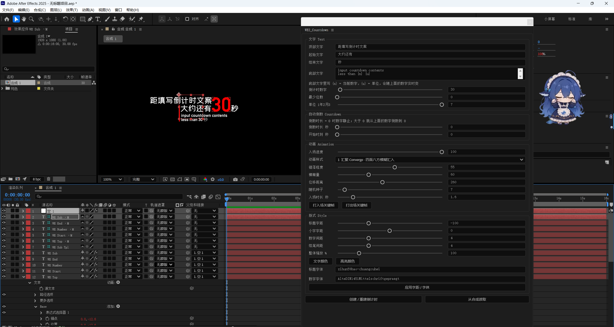

# WE2 Countdown

《流浪地球 2》倒计时版式的 After Effects 面板：红竖条、顶部小标题、「大约还有 30 秒」、底部英文小字。

版式数据取自 [lab.wsm.ink/the-wandering-earth-2-countdown](https://lab.wsm.ink/the-wandering-earth-2-countdown) 的源码，字号、字距、行距都按原站数值来（红条 4×68，起始文字 36px，数字 84px，小字 18px）。

场景全部用 AE 原生图层生成，不依赖预渲染素材：文字始终可编辑，改文案、字距、位数之后，后面的元素靠表达式自动重排。

## 环境

- After Effects 2020–2025（Windows）
- 单文件脚本，不联网、不写注册表，卸载就是删文件

## 安装

1. 安装 `fonts/` 里的两个字体：标题用的字魂59号-创粗黑、数字用的 Alte DIN 1451
2. 把 `WE2_Countdown.jsx` 放进 After Effects 的 `Support Files\Scripts\ScriptUI Panels\`
3. 重启 AE，菜单「窗口 → WE2_Countdown.jsx」；也可以「文件 → 脚本 → 运行脚本文件」临时运行

两个字体是必须装的——插件的进退格按这两个字体的字宽计算，缺了整套排版的比例和字间距就全散了。详细步骤、面板逐项说明和常见问题见 [安装教程.md](安装教程.md)。

## 用法

1. 在项目面板里选中一个合成（插件只往当前激活的合成里建）
2. 点「创建 / 重建倒计时」
3. 拖「入场进度」预览入场动画，满意后点「打入场关键帧」，把动画烘成真关键帧

数字支持 0–999、补零、按年/月/周/天/小时/分钟/秒自动倒数；底部英文小字里的 `{n}`、`{u}` 会跟着数字实时变。三套动画样式（汇聚 / 升起 / 展开）切换是瞬时的，不用重建场景。

## 生成到合成里的东西

13 个图层，全部挂在 `WE Controller` 空对象下面，想整体挪动或缩放，只动它就行。带 `·M` 后缀的是测量用的隐藏孪生层，别删——排版宽度都靠它们量。

## 改代码前

脚本头部注释里有完整的版式数据和 11 条修复记录，先看那个。几条硬约束：

- ExtendScript 是 ES3：没有 `let`/`const`、箭头函数、模板字符串、`JSON`、数组迭代方法，用 `var` + `for`
- 控制器上的效果按名字取（`C.effect("Progress")(1)`），改名或调序会让面板和场景对不上，新增效果请加在末尾
- 带 Text Animator 的层不能用 `sourceRectAtTime` 直接量宽——飞出去的字符会算进包围盒，必须量孪生层
- `__WE_TEST__` 分支要在 `buildUI` 之前 `return`，否则用 `afterfx -r` 跑自动化测试时会把面板真的弹出来，挂死进程

## 已知限制

- 换字体必须重建场景：AE 不允许给已有文字的层换字体，`td.font` 会静默失败
- 逐字动画靠 Expression Selector，字符不能单独打关键帧；要独立控制，先用「打入场关键帧」把 Progress 烘出来
- 数字 `1` 的字宽只有 71/1000 em（其它数字是 101），个位数变 1 时整行会左缩一点。这是 Alte DIN 1451 的原始字形，原站也这样，为了对齐原设计保留了

## 字体版权

`fonts/` 里两个字体归各自作者所有，仓库附带只为保证排版一致，商用前请自行确认授权。

## 许可

代码部分按 [MIT](LICENSE) 发布。
